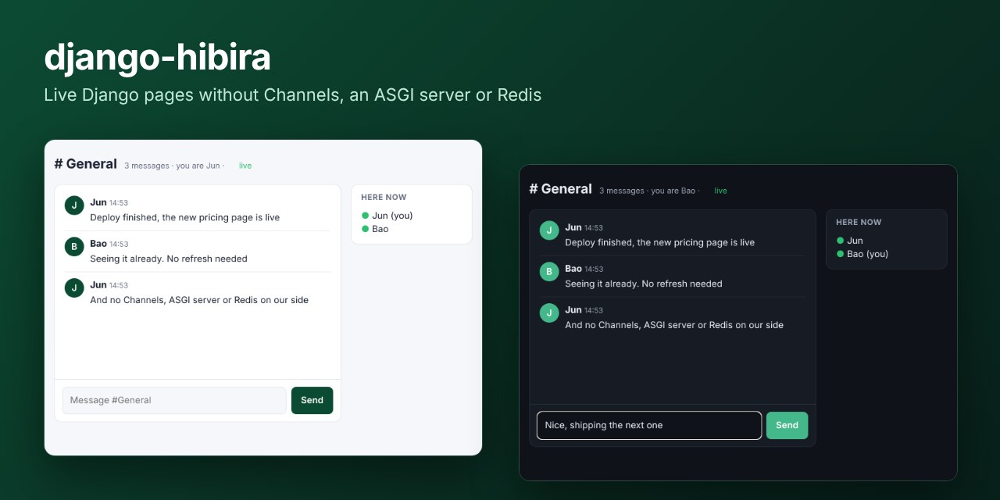
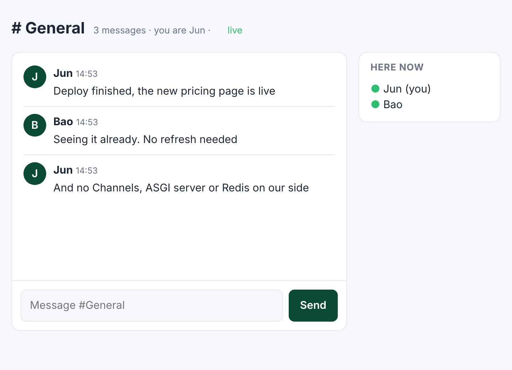
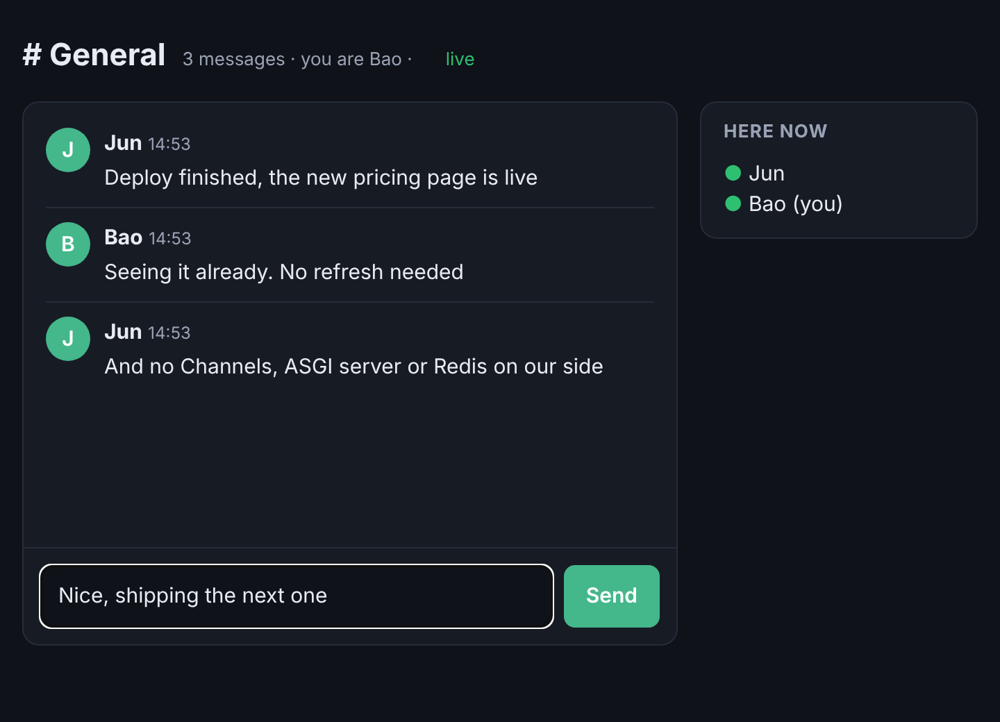

# django-hibira



[](https://github.com/hibira-io/django/actions/workflows/ci.yml)

Live Django pages over [Hibira](https://hibira.io), with no Django Channels,
ASGI server or Redis to run.

Hibira is a hosted realtime service that speaks the Pusher Channels protocol.
With this package your ordinary WSGI Django app renders HTML fragments as it
already does and broadcasts them: every open page appends, replaces or removes
them as they happen. It also signs your own private and presence channels,
verifies webhooks and serves push notification tokens.

- **Model broadcasts**: one decorator makes a list live on every page.
- **Live HTML**: send any template fragment to any page, from views, Celery
  tasks, management commands or the shell.
- **Waits for the commit**: nothing is sent for a rolled-back transaction.
- **Works with htmx** (new fragments are processed) and Turbo 8 (refreshes morph).
- **No build step**: one script tag, pusher-js included.

Supports Django 4.2, 5.1, 5.2, 6.0 and 6.1 on Python 3.10+.

## Install

```sh
pip install django-hibira
```

```python
# settings.py
INSTALLED_APPS = [
    # ...
    "django_hibira",
]

# urls.py
from django.urls import include, path

urlpatterns = [
    # ...
    path("hibira/", include("django_hibira.urls")),
]
```

Copy the app ID, key and secret from your app page on
[hibira.io/portal](https://hibira.io/portal) (the free plan needs no card)
into the environment:

```sh
HIBIRA_APP_ID=your-app-id
HIBIRA_APP_KEY=your-app-key
HIBIRA_APP_SECRET=your-app-secret
```

The secret is shown only once, when you create the app; the app ID and key
stay under Overview → Credentials. On the Free plan, allowed origins can't be
`*`: add every origin your pages load from (`http://localhost:8000` while
developing, plus your production domain), or browsers are refused.

Then check them:

```sh
python manage.py hibira_check
```

Add the scripts to your base template's `<head>`:

```django

<head>
  ...
  
</head>
```

## Make a list live

```python
# chat/models.py
from django.db import models
from django_hibira import broadcasts


@broadcasts(to="room", target="messages")
class Message(models.Model):
    room = models.ForeignKey(Room, on_delete=models.CASCADE, related_name="messages")
    body = models.TextField()
```

```django
{# chat/_message.html: the root element carries the message's dom_id #}

<li id="">{{ message.body }}</li>
```

```django
{# chat/room.html #}


<ul id="messages">
  
</ul>
```

That's all. Creating a message renders `chat/_message.html` and appends it to
`#messages` on every page showing that room; saving it again replaces
`#message_<pk>`; deleting it removes the element. It works the same whether the
row was saved by a view, the admin, a Celery task or `manage.py shell`.

`broadcasts()` options:

| Option | Default | |
|---|---|---|
| `to` | the model class | The stream: an attribute path (`"room"`, `"room.workspace"`), a callable taking the instance, or None |
| `target` | plural model name (`messages`) | Element ID new rows go into |
| `insert` | `"append"` | Or `"prepend"` |
| `template` | `<app>/_<model>.html` | The row partial |
| `context_name` | model name (`message`) | The instance's name in the partial |
| `refresh` | `False` | Send a page refresh instead of fragments |
| `on` | create, update, delete | Which changes to broadcast |

`@broadcasts(to="project", refresh=True)` is the quickest way to make a page
live: each change tells the open pages to fetch themselves again (several
changes in a row become one fetch, the scroll position is kept, and a field
someone is typing in is never thrown away).

## Broadcast anything

```python
import django_hibira

django_hibira.broadcast_append(room, target="messages",
                               template="chat/_message.html", context={"message": message})
django_hibira.broadcast_update(room, target="count", html=str(room.messages.count()))
django_hibira.broadcast_replace(order, target=order, template="orders/_status.html",
                                context={"order": order})
django_hibira.broadcast_remove(room, target="message_12")
django_hibira.broadcast_refresh(dashboard)
```

The actions are `append`, `prepend`, `replace`, `update` (inner HTML),
`before`, `after`, `remove` and `refresh`. `target` is an element ID, or a model
instance for its `dom_id`; `targets=".unread-count"` hits every element that
matches a CSS selector. The fragment is `html=` or `template=` with `context=`.

A *stream* is anything pages can watch: a model instance (`chat.room:5`), a
model class (`chat.message`), a string, or several together
(``). Each stream maps to a private channel,
and `` renders the stream name signed with your
`SECRET_KEY`, so a browser can only watch streams your views rendered for it.

Broadcasts made inside a transaction are sent after it commits, and dropped if
it rolls back (`on_commit=False` sends at once). Delivery errors are logged to
the `django_hibira` logger and never break the request that saved the data.

### Skip the sender

htmx requests carry the browser's socket ID. Pass it on, and the browser that
made the change is left out (it usually swapped its own HTML already):

```python
django_hibira.broadcast_append(room, target="messages", html=html,
                               socket_id=django_hibira.socket_id(request))
```

Appending or prepending an element whose ID is already in the list replaces it,
so leaving `socket_id` out never shows a row twice.

### In the browser

New fragments are processed by htmx when it is on the page, and Alpine.js
picks them up on its own. `hibira:before-swap` (cancelable) and
`hibira:swapped` fire on the target element, and `hibira:refreshed` on the
document. `<hibira-stream>` gets a `connected` attribute while subscribed.
Inline `<script>` tags in fragments don't run.

## Your own channels and presence

`window.Hibira.client()` is the page's pusher-js client:

```javascript
const channel = Hibira.client().subscribe("presence-room.1")
channel.bind("pusher:member_added", (member) => console.log(member.info.name))
```

Private and presence subscriptions are signed by `POST /hibira/auth`, which
asks your function (CSRF protection applies, as on the rest of your site):

```python
# settings.py
HIBIRA = {"AUTHORIZE_CHANNEL": "chat.realtime.authorize"}

# chat/realtime.py
def authorize(request, channel):
    if not request.user.is_authenticated:
        return False
    if channel.startswith("presence-room."):
        return {"user_id": request.user.pk, "user_info": {"name": request.user.get_full_name()}}
    return channel == f"private-user.{request.user.pk}"
```

Send plain events to them from Python:

```python
django_hibira.trigger(f"private-user.{user.pk}", "invoice.paid", {"id": invoice.pk})
```

For anything else in the [Python SDK](https://github.com/hibira-io/python)
(batch events, channel info, push, approvals, AI streaming),
`django_hibira.get_client()` returns the configured `hibira.Client`.

## Webhooks

Add `https://your-site/hibira/webhooks` on your app page → Webhooks. Each
verified event runs your handlers (both the current and, during a secret
rotation, the previous secret are accepted):

```python
from django_hibira import on_webhook

@on_webhook("channel_vacated")
def room_emptied(event):
    Room.objects.filter(slug=event["channel"].removeprefix("presence-room.")).update(live=False)
```

The `django_hibira.webhook_received` signal carries every event too.

## Push notifications

Set `HIBIRA_PUSH_INSTANCE_ID` and `HIBIRA_PUSH_SECRET_KEY` (app page → Push
notifications), and `GET /hibira/push/token?user_id=<pk>` returns a user token
for the signed-in user, for `setUserId` in the web, Android and iOS push SDKs.
Send with `django_hibira.get_client().push_to_users([...], {...})`.

## Waiting room

Put a [Hibira waiting room](https://github.com/hibira-io/waiting-room) in front
of a ticket drop or launch page. Visitors without a pass are sent to the hosted
queue page; when it's their turn they come back with a signed pass, which is
checked and kept in an HttpOnly cookie.

```python
from django_hibira.waiting_room import waiting_room

@waiting_room("presale")
def drop(request):
    number = request.hibira_pass.number  # also ticket_id, expires_at
    ...
```

Or protect path prefixes for the whole site:

```python
MIDDLEWARE = [..., "django_hibira.waiting_room.WaitingRoomMiddleware"]
HIBIRA = {"WAITING_ROOMS": {"/drop/": "presale"}}
```

Non-GET requests without a pass get a `403`. Create the room (rate, start time,
`return_urls`) with the [waiting rooms API](https://github.com/hibira-io/pusher-server/blob/master/docs/waiting-rooms.md). A pass is valid
for 30 minutes by default and works in any browser; if each queue number may
check out once, record `request.hibira_pass.ticket_id` and refuse a repeat.
`verify_pass(token, secret, room=...)` checks a pass anywhere else.

## Settings

Everything goes in one optional `HIBIRA` dict. Connection settings fall back to
environment variables.

| Key | Environment | Default |
|---|---|---|
| `APP_ID`, `KEY`, `SECRET` | `HIBIRA_APP_ID`, `HIBIRA_APP_KEY`, `HIBIRA_APP_SECRET` | |
| `HOST`, `PORT`, `USE_TLS` | `HIBIRA_HOST`, `HIBIRA_PORT`, `HIBIRA_USE_TLS` | `ws.hibira.io`, 443, true |
| `PUSH_INSTANCE_ID`, `PUSH_SECRET_KEY`, `PUSH_ENDPOINT` | `HIBIRA_PUSH_*` | |
| `AUTHORIZE_CHANNEL` | | None (only streams can be subscribed to) |
| `PUSH_USER_ID` | | `request.user.pk` |
| `ON_COMMIT` | | `True` |
| `OVERSIZE` | | `"refresh"`: a fragment over the plan's message size limit becomes a page refresh; or `"log"`, `"raise"` |
| `ENABLED` | | on when the credentials are set; `False` turns sending off |
| `CLIENT_OPTIONS` | | `{}`, extra `hibira.Client` arguments such as `timeout` |
| `WAITING_ROOMS` | | `{}`, path prefix → room for `WaitingRoomMiddleware` |

Use the HOST shown on your app page if the app lives outside the default region.

## Testing

```python
from django_hibira.testing import capture_broadcasts

@pytest.mark.django_db(transaction=True)
def test_new_message_is_appended(room):
    with capture_broadcasts() as sent:
        Message.objects.create(room=room, body="hi")
    assert sent[0].action == "append"
    assert sent.for_stream(room)[0].html.count("hi") == 1
```

Inside `capture_broadcasts()` nothing is sent. Broadcasts wait for the commit,
which Django's `TestCase` never does: use `TransactionTestCase`,
`self.captureOnCommitCallbacks(execute=True)`, or pytest-django's
`transaction=True` / `django_capture_on_commit_callbacks`.

## Example

[`example/`](example) is a chat room with live messages and a "here now"
presence list. Two browsers, light and dark:

 

```sh
cd example
pip install -e ..
export HIBIRA_APP_ID=... HIBIRA_APP_KEY=... HIBIRA_APP_SECRET=...
python manage.py migrate && python manage.py runserver
```

## Development

```sh
pip install -e ".[test]"
pytest
```

## 中文摘要

django-hibira 讓一般的 Django（WSGI）專案不必架 Django Channels、ASGI 伺服器或 Redis，就能讓頁面即時更新。在 model 上加一行 `@broadcasts(to="room", target="messages")`，新增、修改、刪除資料時，所有開著該頁面的瀏覽器會自動插入、替換或移除對應的 HTML 片段；也可以用 `broadcast_append` 等函式從 view、Celery 任務或管理指令推送任何模板片段。廣播會等交易 commit 後才送出，並支援 htmx、Turbo 8、私有/presence 頻道授權、webhook 驗證與推播 token。到 [hibira.io/portal](https://hibira.io/portal) 建立 app（免費方案不需信用卡），設定 `HIBIRA_APP_ID`、`HIBIRA_APP_KEY`、`HIBIRA_APP_SECRET` 即可開始。

等候室（waiting room）：在搶票或限量開賣的 view 加上 `@waiting_room("presale")`，或在 `MIDDLEWARE` 加 `WaitingRoomMiddleware` 並設定 `HIBIRA["WAITING_ROOMS"]`，沒有 pass 的訪客會被導到 Hibira 託管的排隊頁，輪到時帶著簽名 pass 回來並存成 HttpOnly cookie。

## License

MIT
